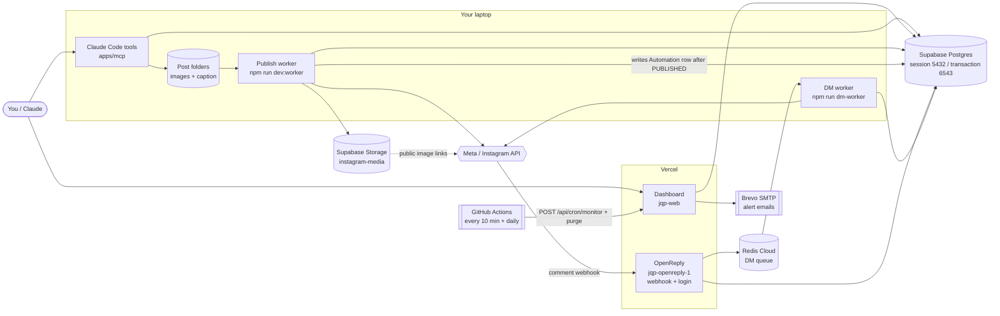

# Architecture: the whole system on one page

Two systems share one database and one Meta app. Ours **publishes posts**. OpenReply (vendored, unmodified) **answers comments with DMs**. Our code hands each published post to OpenReply by writing a row into its `Automation` table.

## Where each piece runs, and what happens if it stops

| Piece | Runs on | If it is down |
|---|---|---|
| Dashboard (`apps/web`) | Vercel `jqp-web` | You can't use the UI. Nothing else stops. |
| OpenReply web + webhook | Vercel `jqp-openreply-1` | Comments are not received, so no DMs are triggered. |
| **Publish worker** (`apps/worker`) | **your laptop** | Queued posts wait; nothing is lost. |
| **DM worker** (`npm run dm-worker`) | **your laptop** | Comments queue in Redis and are answered on restart, within Meta's 7-day window. |
| Database | Supabase | Everything stops. No automatic backups: use `npm run backup`. |
| Redis | Redis Cloud | DMs cannot be queued. |
| Monitor + retention | GitHub Actions calling `/api/cron/*` | No alert emails, no cloud data cleanup. Needs two GitHub settings. |

## Where the code lives

| Folder | Purpose |
|---|---|
| `apps/web` | Dashboard: Home, Posts, Automations, Activity, System, Settings. Also the `/api/cron/*` endpoints. |
| `apps/worker` | Publish worker (pg-boss queue). |
| `apps/mcp` | Claude Code tools (health, posts, campaigns, publish). |
| `packages/core` | Config (`env.ts`), database client, logging, encryption. |
| `packages/meta` | Meta API client, OAuth, publishing calls, rate-limit handling. |
| `packages/publisher` | Publish state machine, the bridge to OpenReply, monitoring (`system`, `alerts`, `events`), message cleaning. |
| `packages/queue`, `packages/storage` | Job queue; image upload. |
| `vendor/openreply` | The DM engine. Do not edit. |
| `supabase/migrations` | SQL, applied by hand. |
| `scripts` | Operations: `doctor`, `smoke`, `backup`, `set-env`, `rotate-db-password` and others (see README). |

## How a post becomes DMs

1. A folder (`caption.md` + `1.jpg`...) is registered as a post (`ingest_post_folder`).
2. The publish worker uploads the images to storage, builds the carousel with Meta, and publishes it. The post is `PUBLISHED`.
3. The bridge (`packages/publisher/src/openreply-bridge.ts`) writes an `Automation` row keyed by the new Instagram media ID.
4. Someone comments the keyword. Meta calls OpenReply's webhook, which queues a job in Redis.
5. The DM worker sends the reply (and, in two-step mode, the link after a button tap), and logs it in `DmLog`.

## Settings that must differ on purpose

| Variable | Dashboard / worker | OpenReply (Vercel and local worker) |
|---|---|---|
| `DATABASE_URL` port | **5432** (session pooler; pg-boss needs it) | **6543** (transaction pooler; stops it exhausting connections) |
| Build command | default | `npx prisma generate && npx next build` (no migrate; run migrations by hand) |

Use `npm run set-env`, `set-database-url`, `set-redis` or `rotate-db-password`; they apply the right port for each. Do not paste URLs by hand.

## Checking it

`npm run doctor` (inside), `npm run smoke` (the live site), System page in the dashboard, `npm run backup` before risky changes.
