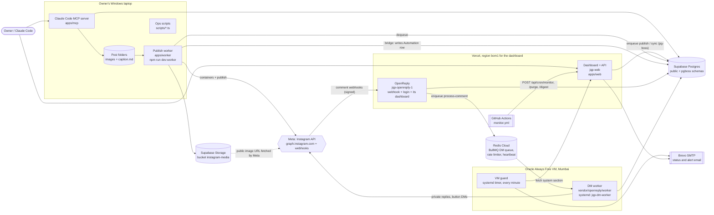

# 01. Architecture and code map

How the system is put together, where every piece runs, how data and control flow, and where the code lives. Facts here were read from the source on 2026-10-21 (file paths are given so you can re-check). For the database see file 02, the dashboard file 03, external services file 04, production operations file 05.

## 1. The whole system on one page



Two systems, one database, one Meta app:

| Half | Code | Responsibility |
|---|---|---|
| Our publisher | `packages/*`, `apps/web`, `apps/worker`, `apps/mcp`, `scripts/`, `ops/` | Scan folder, validate, upload, publish via Meta's container flow, dashboard, monitoring, ops tooling |
| OpenReply | `vendor/openreply` (unmodified) | Receive Meta webhooks, match keywords, send private replies and button DMs, public replies, its own login/dashboard |

## 2. Where each piece runs, and what happens if it stops

| Piece | Host | If it is down |
|---|---|---|
| Dashboard `apps/web` (Next.js 15.5 app router, region `bom1`; OpenReply itself is Next.js 16) | Vercel project **`jqp-web`**, https://jqp-web-tau.vercel.app | You cannot use the UI or cron endpoints; DMs and the VM keep working |
| OpenReply web + webhook | Vercel project **`jqp-openreply-1`**, https://jqp-openreply-1.vercel.app | Meta cannot deliver comments, so no DMs are triggered. Comments Meta retries (for up to 36 hours) and the worker's 72 hour poll partly cover a short gap |
| **DM worker** | **Oracle VM** `jqp-dm-worker` (ubuntu@130.210.51.252), systemd unit `jqp-dm-worker` | Comments queue in Redis; they are answered when it returns, within Meta's 7 day window. Guard emails you within about a minute; the dashboard monitor notices the stale heartbeat within 30 minutes |
| **VM guard** | Same VM, systemd timer `jqp-vm-guard.timer` (every 60 s) | If the whole VM dies it cannot email; the GitHub monitor and the missing 6-hourly email are the signals |
| **Publish worker** `apps/worker` | **Owner's laptop only**, started by hand (`npm run dev:worker`) | Queued publishes wait in Postgres; nothing is lost. Campaign syncs (`sync-campaign-to-openreply`), the weekly token refresh and the nightly purge job also run in this process, so they only run while it is up |
| Database + Storage | Supabase `jqp` (ref `rligoaiclwjwfbixnrry`, ap-south-1) | Everything stops. Free plan has no automatic backups: use `npm run backup` |
| Redis | Redis Cloud, plain `redis://` | DMs cannot be queued |
| Monitor + retention + digest | GitHub Actions `monitor.yml` calling `/api/cron/*` | No dashboard-originated alert emails or cloud retention; VM guard emails continue |

### Why the publish worker is local
`runPublishPipeline` calls `scanPostFolder(post.folder_path)` and `folder_path` is a path on the owner's disk (for example `D:\jqp\posts\01_dot-and-key`). A remote host fails with ENOENT. Therefore: ingest and publish are local operations; ingesting a folder through the deployed dashboard cannot work (the Vercel function cannot see the disk). Only the DM worker needs 24/7 hosting. Starting the publish worker immediately consumes **any jobs already waiting** in Postgres (`docs/PUBLISHING.md`, uncommitted, warns about this).

## 3. Monorepo layout

npm workspaces: `packages/*`, `apps/*`. Node >= 20 (VM uses 22). TypeScript strict, ESM. Root `tsconfig.base.json`. `@jqp/*` packages compile to `dist/` (gitignored): **always run `npm run build:packages` before building or typechecking apps** (a stale `dist` made `tsc` in `apps/web` fail on 2026-10-14). The build order is spelled out in `package.json`: core, meta, storage, queue, publisher. `@jqp/ai` is excluded (optional, needs AWS SDK, off by default).

```
D:\jqp
├── apps/
│   ├── web/        Next.js dashboard + all HTTP API routes (Vercel: jqp-web)
│   ├── worker/     Publish worker: pg-boss consumers + health server (local)
│   └── mcp/        Claude Code MCP server "jqp" (stdio)
├── packages/
│   ├── core/       env schema (zod), db client, logger, AES-GCM crypto, errors, edge-safe session HMAC
│   ├── meta/       Graph API client, OAuth/token calls, container + publish calls, messaging, webhook parse/verify, usage/rate headers, mock server
│   ├── storage/    Supabase Storage upload/delete/preflight
│   ├── queue/      pg-boss singleton, queue names, enqueue + worker registration, schedules
│   ├── publisher/  pipeline state machine, repository (all SQL), OpenReply bridge, scanner, validator, system snapshot, alerts, digest, events, retention, token refresh, launch review, message cleaning, stats
│   └── ai/         optional Bedrock caption generation (AI_ENABLED=false)
├── vendor/openreply/   DM engine (do not edit)
├── ops/
│   ├── dm-worker/selfcheck.ts   read-only preflight bundled for the VM
│   └── vm/                      guard-core, vm-guard, vm-report, install.sh, jqp-ctl.sh, systemd units
├── scripts/        operations tooling (section 9)
├── supabase/migrations/  0001 to 0008 SQL (applied with npm run migrate)
├── docs/           all documentation (docs/context is this set)
├── posts/          content folders staged for ingest (POST_001, POST_002, 01_dot-and-key, ...)
├── POST-F/05_FINAL/  delivery folder from the content team (index.json + post.json per post)
├── .github/workflows/monitor.yml
├── .mcp.json       registers the jqp MCP server for Claude Code
└── CLAUDE.md, README.md, DESIGN.md
```

## 4. The publish pipeline (state machine)

File: `packages/publisher/src/pipeline.ts`. One pg-boss job `publish-post` runs the **whole** pipeline, including Meta's container polling (safe because the worker is a long-lived process). Every transition is written to `posts.status` before the next step, and the function re-reads the row first, so a crashed run resumes from the last status.

```
DISCOVERED -> VALIDATING -> UPLOADING -> CREATING_CHILDREN -> WAITING_FOR_CHILDREN
           -> CREATING_CAROUSEL -> WAITING_FOR_CAROUSEL -> PUBLISHING -> PUBLISHED
           (terminal failures: VALIDATION_FAILED, FAILED)
```
Single-image posts skip the child steps (UPLOADING goes straight to CREATING_CAROUSEL, which for `media_type = IMAGE` creates one image container).

| Step | What happens | Key detail |
|---|---|---|
| ingest (`ingestPostFolder`) | `scanPostFolder` then `upsertDiscoveredPost` | Idempotent by `campaign_id` (folder name). Re-ingesting never changes an existing row, even a PUBLISHED one |
| validate | `validatePost` | 1 to 10 images named `N.jpg/jpeg/png` (optional `-label` after the number), only `caption.md` besides images, aspect ratio 0.79 to 1.92, each encoded image <= 8 MB, PNG converted to JPEG (sharp) |
| upload | `uploadPostMedia` to bucket `instagram-media` at `{campaignId}/{sequence}-{sanitizedName}` with upsert, then `preflightMediaUrl` | Skips rows that already have `public_url` (resume safe) |
| children | `createChildContainer` per image (skips rows with `child_container_id`) | Needs a **verified** account (below) |
| wait | `pollContainerUntilReady` every 2 s up to 30 polls; ERROR/EXPIRED are non-retryable, still-IN_PROGRESS is retryable | |
| carousel | `createCarouselContainer` (or single image container) with the caption | |
| wait | poll again, then **compare-and-set** `WAITING_FOR_CAROUSEL -> PUBLISHING`; if another runner won, throw `ConcurrentRunError` and stop quietly | Prevents two runners publishing one post |
| publish (`stepPublish`) | See "never publish blind" below | The only call Meta cannot undo |
| after publish | status `PUBLISHED` (compare-and-set from PUBLISHING) with `instagram_media_id` and `published_at`; **delete the uploaded images from the public bucket** (best effort, keeps `post_media` rows for audit); if the post's campaign is enabled, enqueue `sync-campaign-to-openreply` | The sync enqueue never fails the job (the post is already live); a failure is recorded as event `campaign_sync_enqueue_failed` |

### Never publish blind (`stepPublish`)
1. If another runner already finished the post, return.
2. Resolve and **verify** the account (below).
3. Read the container status. `EXPIRED`/`ERROR` -> non-retryable failure ("Retry to build a fresh one").
4. If the container is already `PUBLISHED`: find the live media by caption + timestamp in the account's 25 most recent media (3 lookups, 2 s apart because Instagram's list lags). Not found -> non-retryable `LIVE_CHECK_REQUIRED:` failure telling the human to look at the profile.
5. Else look for a matching live post anyway (same normalised caption, published after the row was created, not recorded against another post). If another **unpublished** post has the same caption, refuse (`LIVE_CHECK_REQUIRED`) rather than guess.
6. Only then call `publishMedia` (a single HTTP attempt, no retry). If Meta rejects with a 4xx (not auth), look again for a live match before failing.
7. Record `PUBLISHED` with compare-and-set; if another runner already recorded it, skip the follow-ups.

### Account verification (`resolveVerifiedAccount`)
`resolveAccountForPost` (repository) picks the account: the post's `ig_account_id` if set (decrypts the stored token; missing/inactive/undecryptable is an `AuthError`, permanent), otherwise the default account `META_IG_USER_ID` (a stored, non-expired, decryptable token wins over the env bootstrap `META_LONG_LIVED_ACCESS_TOKEN`, which is kept as a fallback if Instagram rejects the stored one). Then it calls Instagram to confirm the token's account id equals the expected one; a mismatch raises non-retryable `TOKEN_ACCOUNT_MISMATCH` ("Nothing was published. Run: npm run connect-account"). The answer is cached 10 minutes per token. **Note:** nothing sets `posts.ig_account_id` today (true multi-account is a before-scaling item), so every post uses the default account.

### Retry safety
`resetPostForRetry` (repository) resets a FAILED/VALIDATION_FAILED post, clears dead containers, and refuses if the post has a media id or its failure carries `LIVE_CHECK_REQUIRED` unless the caller passes `confirmNotLive`. Retry enqueues with its own singleton key so the 30 second double-click throttle cannot swallow it.

### Error taxonomy (`packages/core/src/errors.ts`)
`AppError` -> `ValidationError`, `RetryableError` (-> `RateLimitError` with `retryAfterMs`), `NonRetryableError` (-> `AuthError`). The pipeline writes `FAILED` only for non-retryable errors, only from an active status, so a runner that lost a race can never overwrite `PUBLISHED`. Retryable errors rethrow so pg-boss retries.

## 5. The bridge: campaign to OpenReply automation

File: `packages/publisher/src/openreply-bridge.ts` (the one place that knows OpenReply's schema). Triggered by the `sync-campaign-to-openreply` job (enqueued when a campaign is saved enabled on a PUBLISHED post, or right after a publish).

Rules:
- **Off means off:** if the campaign is disabled and has an `openreply_automation_id`, set `Automation.isActive=false` and finish.
- Does nothing (not an error) unless the post is `PUBLISHED` with an `instagram_media_id` and the campaign is enabled.
- Looks up OpenReply's `InstagramAccount` by `instagramId`; missing -> non-retryable `OPENREPLY_ACCOUNT_NOT_CONNECTED`, campaign marked `DM_SYNC_FAILED`.
- `matchAnyWord = (no keywords)`. `wholeWordMatch = match_mode != PARTIAL`. The link travels inside the DM text via `dmTextWithLink` (OpenReply has no separate link field).
- Two-step is used only if the opening DM is enabled **and** both its message and button label are non-empty; otherwise it falls back to the single DM with a warning. Meta caps are applied here: opening message truncated to 640 chars, button label to 20.
- **Idempotent create:** the Automation id is derived from the campaign (`automationIdForCampaign`), an existing automation named `jqp:%` for the same post/account is reused, and the insert uses `on conflict ("id") do update`, so a retry cannot create a second automation (which would answer every comment twice). `isActive` is re-read from `campaigns.enabled` inside the same statement so a concurrent switch-off wins.
- Sync status moves `DM_SYNC_PENDING -> DM_SYNCING -> DM_SYNCED | DM_SYNC_FAILED` (`campaigns.sync_status`, `sync_error`).
- Non-retryable errors end the job; other errors are rethrown as retryable.

`npm run doctor` verifies the bridge's **column contract** (21 columns of `Automation`) still matches the live table; run it after any OpenReply update.

## 6. Comment to DM, end to end

1. Meta POSTs a signed webhook to `https://jqp-openreply-1.vercel.app/api/webhook` (`x-hub-signature-256` verified against the app secret; failures are recorded as an `OperationalEvent` warning and return 401).
2. OpenReply writes a `WebhookEvent`, parses comment events and adds a BullMQ job `process-comment` to Redis with `jobId = comment_<accountId>_<commentId>` (dedup). Button taps (`messaging_postbacks`) and inbound DMs are queued as other job types.
3. The **DM worker** (`createDMWorker`, concurrency 5, retry backoff 5 / 15 / 45 minutes) loads active automations for the media id (or any-post automations), keyword-matches (`matchAnyWord` or `matchKeywords`), de-duplicates via the unique `(automationId, commentId)` on `DmLog`, and reserves a slot in the Redis rate limiter (**750 per hour per account**, fixed window, requeue after 30 minutes up to 3 times).
4. With an opening DM: sends a private reply with a button whose payload is `reveal:<automationId>`. Without: sends the link DM as the private reply. Optional public comment reply (one of `publicReplyMessages`) is idempotent via `publicReplySentAt`.
5. On the button tap, the postback job `processPostback` sends the link DM as a normal DM (and optionally a delayed follow-up).
6. A **polling reconciler** in the worker process (`COMMENT_POLL_INTERVAL_MS`, default every 5 minutes) asks Meta for recent comments on active campaign posts and queues any matching comment the owner has not already replied to, because webhooks are best effort. Its defaults are a 72 hour look-back (`COMMENT_POLL_LOOKBACK_HOURS`), but **the deploy script writes `COMMENT_POLL_LOOKBACK_HOURS=1` and `COMMENT_POLL_MAX_PER_SWEEP=5` into the VM's `worker.env`, and the live VM has exactly those values (read 2026-10-21)**. They were chosen so that the first start could never replay a backlog in a burst, but they also mean the safety net only covers the last hour and 5 comments per sweep. `docs/ORACLE-WORKER.md`'s "72 hour catch-up" claim is therefore NOT true for the current VM. To restore it: `node --import tsx scripts/deploy-dm-worker.ts --host ... --key ... --push-env --lookback-hours 72 --restart` (owner decision; `docs/REMEDIATION-PLAN.md` B7).
7. The worker writes a heartbeat key in Redis (`health:worker:dm`, TTL 120 s) every 30 s; OpenReply's `/api/health` and our System page read it.

Idempotency stack: BullMQ `jobId`, unique `(automationId, commentId)` on `DmLog`, `ProcessedComment` shared dedup set, skip when `status = SENT`. Known tiny window: a crash between Meta accepting a DM and the row being marked SENT can double-send one DM (rare; avoid restarting the worker while a big backlog drains).

## 7. Queues and schedules (our side)

`packages/queue/src/jobs.ts`, pg-boss in schema `pgboss` (pool max `BOSS_POOL_MAX`, default 3):

| Queue | Producer | Consumer | Notes |
|---|---|---|---|
| `publish-post` | dashboard publish route, MCP `publish_post`, retry route | publish worker | `singletonKey post:<id>` with `singletonSeconds: 30` (double-click throttle); `retryLimit 8`, `retryDelay 60`, exponential backoff (about 4 hours of retries for Meta throttles); `expireInSeconds 900` |
| `sync-campaign-to-openreply` | campaign save, pipeline after publish | publish worker | queue defaults: 3 retries, 30 s base, backoff, 300 s expiry; `singletonKey sync:<campaignId>` |
| `purge-expired-data` | pg-boss schedule `0 4 * * *` UTC | publish worker | retention; also runnable from `/api/cron/purge` |
| `refresh-ig-tokens` | pg-boss schedule `0 3 * * 1` UTC (Mondays) | publish worker | renews stored tokens (60 day long-lived tokens can be refreshed once a day old) |

Workers use `batchSize: 1` so later jobs do not expire waiting on the batch clock. `QUEUE_CONCURRENCY` exists in the env schema but is not what limits throughput (known item SA-08).

## 8. Process startup facts

- `loadRootDotenv()` (`packages/core/src/bootstrap.ts`) loads the single root `.env` for scripts, the worker, `next.config.ts` and the MCP server. `loadEnv()` validates it once with zod (`packages/core/src/env.ts`) and throws an aggregated readable error.
- `vendor/openreply/.env` is **generated** from the root file by `npm run sync-openreply-env` (maps `OPENREPLY_*` and shared `META_*` names to OpenReply's names and forces the transaction pooler port 6543). Never hand-edit it.
- `apps/web/middleware.ts` runs on the Edge runtime and imports only `@jqp/core/edge-safe` (Web Crypto HMAC) because the main entrypoint pulls in `postgres.js`.
- The publish worker exposes a tiny health server on `PORT` or `WORKER_HEALTH_PORT` (default 8080) so it can also run as a Render web service.
- The worker registers a Meta-usage observer that records `meta_usage_high` (>= 75%) and `meta_throttled` events at most every 10 minutes.

## 9. Scripts catalog (`scripts/`, run with `npm run <name>` or `node --import tsx scripts/<file>.ts`)

In **PowerShell 5.1, `npm run x -- --flag` loses the flags**; use `node --import tsx scripts/x.ts --flag` for anything with flags.

| Script (npm name) | Purpose |
|---|---|
| `check-env` | Validate root `.env` against the zod schema |
| `migrate` | Apply `supabase/migrations/*.sql` in order, ledgered in `public._migrations_applied`. Running it locally hits **production** (shared DB) and is deliberately not part of any Vercel build |
| `doctor` | Read-only integration check: env, DB tables, migrations, bridge column contract, OpenReply account, Meta token and webhook subscription, storage, Redis, live System checks. No secrets printed |
| `smoke` | Outside-in test of the deployed sites (login, pages, cron token refusal, cross-site POST block, webhook verify, anon-key lockdown). Needs `SMOKE_WEB_URL` and `SMOKE_OPENREPLY_URL` because the local env points at localhost |
| `backup` | Read-only snapshot of every table to `backups/<timestamp>/` (git-ignored, contains personal data) |
| `check-redis` | Host, TLS and PING for the DM queue |
| `set-env`, `set-redis`, `set-database-url`, `rotate-db-password` | Replace a secret everywhere (root env, OpenReply env, Vercel) after validating it, never printing it; env backups go to `D:\jqp-private\env-backups` |
| `connect-account` | Store the publishing token for an Instagram account (encrypted) after validating it names the expected account (`--expect addaddy.ai --check` first); stop the publish worker first and restart after |
| `connect-openreply-account` | Register our stored account inside OpenReply without browser login (writes `InstagramAccount` encrypted with OpenReply's key, subscribes `comments`, `messages`, `messaging_postbacks`) |
| `ingest` (`ingest-folder.ts`) | Register a post folder as DISCOVERED |
| `stage-post-kit.ts` | Turn a delivery folder post (`index.json` + `post.json`) into `posts/<id>/` plus a DISCOVERED post and an OFF campaign. Never publishes, never enables |
| `build-preview.ts` | Read-only HTML preview of a delivery folder with per-post rule checks |
| `generate-caption` | Optional Bedrock caption pre-step |
| `sync-openreply-env` | Generate `vendor/openreply/.env` |
| `bundle-dm-worker` | esbuild the DM worker, selfcheck and guard into `dist/dm-host` with LF service files and a VERSION stamp |
| `deploy-dm-worker.ts` | Ship `dist/dm-host` to the VM over ssh/scp: `--host`, `--key`, `--install`, `--push-env`, `--push-guard-env`, `--restart`, `--dry-run` (see file 05). `--push-env` refuses if `DATABASE_URL` is not on port 6543 |
| `dm-worker` | Run OpenReply's DM worker on the laptop (**sends real DMs**) |
| `mock-meta`, `simulate-webhook` | Offline testing against a fake Graph API and signed fake webhooks |
| `test-email` | Send one test mail through the alert path |
| `mcp:selftest`, `mcp` | Exercise or run the MCP server |
| `purge-dry-run.ts` | Show what retention would delete (`--apply` runs it) |

## 10. Tests

`npx vitest run` (root `vitest.config.ts`) runs **218 tests in 21 files**, none of which touch real Meta, Redis or Supabase:

- `packages/core`: crypto, edge-safe session tokens
- `packages/meta`: errors, publishing, usage headers, webhook signature/parse, a mock-server integration test
- `packages/publisher`: alerts, campaign off-switch, digest, events scrubbing, message text, OpenReply bridge, pipeline (resumability, concurrency, live-media adoption), publishing checks, repository publish safety, scanner, token refresh, validator
- `ops/vm/guard-core.test.ts`: thresholds, state machine, halt logic, report builder
- `packages/ai`: caption generation
- `vendor/openreply/__tests__` has its own vitest suite (run from that folder; not part of the 218)

Real-infrastructure behaviour is verified by `doctor`, `smoke`, the `jqp check` selfcheck on the VM, and live drills (`docs/ORACLE-WORKER.md` section 5b).

## 11. Where to change things

| You want to | Edit | Then |
|---|---|---|
| Change publish behaviour | `packages/publisher/src/pipeline.ts`, `repository.ts` | add a test in `pipeline.test.ts` / `repository-publish-safety.test.ts`; full gate (file 00 rule 2) |
| Change what a campaign writes to OpenReply | `openreply-bridge.ts` (+ `message-text.ts`) | `openreply-bridge.test.ts`; run `npm run doctor` for the column contract |
| Add a health check | `packages/publisher/src/system.ts` (+ `publishing-checks.ts`) | it automatically shows on the System page, in alerts and in the digest |
| Add an API route | `apps/web/app/api/...` | if under `/api/cron/` it **must** call a bearer-token guard (middleware skips the cookie check) |
| Change the VM guard or status email | `ops/vm/*.ts` | `bundle-dm-worker`, then `deploy-dm-worker --restart` (file 05) |
| Add a migration | new `supabase/migrations/000N_*.sql` (guarded, idempotent) | `npm run migrate`; if it touches OpenReply tables guard with `to_regclass` |
